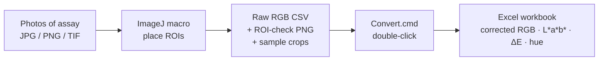

# ImageJ RGB → CIELAB Colorimetry Workflow

Turn ordinary photos of a colorimetric assay into publication-ready
**corrected RGB, CIELAB (L\*, a\*, b\*), ΔE\*ab (CIE76) and hue angle** tables.

1. An **ImageJ / Fiji macro** lets you place black-reference, white-reference
   and sample ROIs on every photo of a batch and saves the raw R/G/B values,
   an ROI-check picture and clean sample crops.
2. A **double-click Windows converter** turns those raw-RGB CSV files into an
   Excel workbook with white-balance / black-level correction, CIELAB,
   ΔE and hue angle — every formula is documented inside the workbook.

No programming and no extra software beyond ImageJ: the converter only uses the
Windows PowerShell that ships with Windows 10/11.



➡️ **Full step-by-step guide: [TUTORIAL.md](TUTORIAL.md)**

---

## When to use it

Good fit:

- **Smartphone / camera read-out of colorimetric assays** — e.g. gold-nanoparticle
  or gold-nanorod (AuNR) etching / aggregation assays, enzyme colour reactions
  (TMB, ABTS, ELISA-type development), pH and indicator dyes.
- **Well plates, PCR tubes, microfluidic chips, paper strips and spot tests**
  photographed against a background that contains a **black** and a **white**
  reference area.
- **Concentration series / calibration curves** (e.g. 0, 31.3, 62.5, 125 pg/mL),
  where you want ΔE or hue angle against a blank.
- **Comparing colour change between conditions** (time points, treatments,
  sample types) with traceable, reproducible ROI positions.
- **Teaching** quantitative colour analysis without coding.

Not a good fit:

- Absolute colorimetry that needs a calibrated camera profile or a
  spectrophotometer (this workflow assumes sRGB and uses a simple
  black/white normalisation, which is ideal for *relative* comparisons).
- Fluorescence / chemiluminescence images, or images with saturated
  (clipped) pixels, strong glare or uneven lighting across the sample.
- Clinical or diagnostic decisions — this is a research tool.
- Photos without any black and white reference in the frame (the converter
  needs at least one of each per image).

## Requirements

| Part | Needs |
|---|---|
| ImageJ macro | [ImageJ 1.53+](https://imagej.net/ij/) or [Fiji](https://fiji.sc/) on Windows, macOS or Linux |
| Converter | Windows 10/11 (built-in Windows PowerShell 5.1). Excel, LibreOffice or WPS to open the result |
| Images | 24-bit RGB JPG, JPEG, PNG, TIF or TIFF, all photos of one batch in one folder |

## Quick start

1. **Download** this repository (green **Code** button → **Download ZIP**) and
   unzip it. On Windows, right-click the ZIP → *Properties* → tick **Unblock**
   before unzipping.
2. **ImageJ:** drag `imagej_macro/Image_J_RGB_Quick_dection.ijm` onto the
   ImageJ/Fiji window and click **Run**. Choose
   *One batch ROI plan + manual positions (RECOMMENDED)* and follow the dialogs.
3. Copy the resulting `Batch__RGB_Raw_ManualROI.csv` (or the whole output folder)
   into `RGB_to_LAB_converter/RawRGB_input/`.
4. Double-click `RGB_to_LAB_converter/Convert.cmd`.
5. Open the workbook in `RGB_to_LAB_converter/output/`.

Want to try the converter first? Copy
`examples/example_Batch__RGB_Raw_ManualROI.csv` into `RawRGB_input` and run
`Convert.cmd`; compare with the example workbook in `examples/`.

## Repository contents

```
imagej_macro/
    Image_J_RGB_Quick_dection.ijm      ImageJ/Fiji macro (ROI placement + raw RGB)
RGB_to_LAB_converter/
    Convert.cmd                        double-click to convert
    RawRGB_input/                      put raw-RGB CSV files or folders here
    output/                            Excel workbooks appear here
    engine/
        Convert_RGB_to_LAB.ps1         the converter (PowerShell, no install)
        conversion_settings_example.json
        README.txt
examples/
    example_Batch__RGB_Raw_ManualROI.csv          4-image AuNR concentration series
    example_Batch__RGB_Raw_ManualROI_LAB_DeltaE_Hue.xlsx   expected result
TUTORIAL.md                            full guide (also usable as lecture notes)
```

## What is calculated

Per image: black = mean of black ROIs, white = mean of white ROIs,
assay = mean of the ROIs of one well.

```
Factor        = 255 / White              (per channel)
Corrected RGB = Assay × Factor − Black
CIELAB        = sRGB (clipped 0–255) → linear RGB → XYZ → L*a*b*  (D65)
ΔE*ab (CIE76) = √(ΔL*² + Δa*² + Δb*²)    vs. the reference condition
Hue angle h°  = atan2(b*, a*) in 0–360°
```

The ΔE reference is the 0-concentration image by default (otherwise the lowest
concentration); it can be changed with `conversion_settings.json`.
See [TUTORIAL.md › The maths](TUTORIAL.md#7-the-maths) for every constant.

## Citation

If this workflow helps your work, please cite the repository (see
[CITATION.cff](CITATION.cff) or the *Cite this repository* button on GitHub).

## License

[MIT](LICENSE) — free to use, modify and share, including commercially, with
the copyright notice kept.
