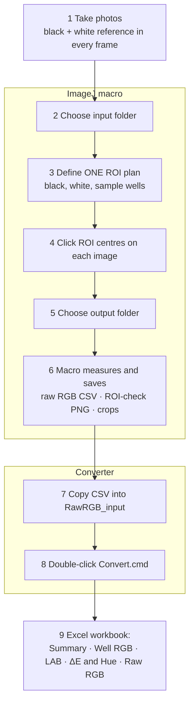

# Tutorial — From Assay Photos to CIELAB, ΔE and Hue Angle

This guide walks through the complete workflow, from taking the photos to
reading the final Excel workbook. It is written so it can also be used as
lecture notes: section 10 gives a suggested teaching outline.

**Contents**

1. [Overview](#1-overview)
2. [Installation](#2-installation)
3. [Taking good photos](#3-taking-good-photos)
4. [Part A — Measure raw RGB in ImageJ](#4-part-a--measure-raw-rgb-in-imagej)
5. [Part B — Convert to CIELAB, ΔE and hue angle](#5-part-b--convert-to-cielab-δe-and-hue-angle)
6. [Optional settings](#6-optional-settings)
7. [The maths](#7-the-maths)
8. [Reading the results](#8-reading-the-results)
9. [Troubleshooting](#9-troubleshooting)
10. [Teaching outline](#10-teaching-outline)

---

## 1. Overview



Why two steps?

- **ImageJ** is the right tool for *looking* at images and placing ROIs. The macro
  only measures; it never edits your photos and never interprets the numbers.
- **The converter** does all the colour science in one transparent place.
  Raw data stay untouched, so you can re-run the calculation with a different
  reference or well selection at any time without re-measuring.

Key terms

| Term | Meaning |
|---|---|
| ROI | Region of interest — an oval area whose mean R, G, B is measured |
| Black / white reference | Areas in the photo that should be black and white (e.g. printed patches, a black and white card) used to correct exposure and white balance |
| Sample group / well | One sample position, e.g. *Well1*. It may contain several ROIs (replicates) that are averaged |
| Condition | What differs between photos — usually a concentration read from the file name |
| CIELAB | Colour space: L\* = lightness (0 black – 100 white), a\* = green(−) ↔ red(+), b\* = blue(−) ↔ yellow(+) |
| ΔE\*ab | Distance between two colours in CIELAB; how different a sample looks from the reference |
| Hue angle h° | Direction of the colour in the a\*/b\* plane (0° red, 90° yellow, 180° green, 270° blue) |

---

## 2. Installation

1. Install **ImageJ 1.53 or newer** (<https://imagej.net/ij/>) or **Fiji**
   (<https://fiji.sc/>). Nothing else is needed for the macro.
2. Download this repository (**Code → Download ZIP**).
   On Windows: right-click the ZIP → *Properties* → tick **Unblock** → OK, then
   extract it. (Without this, Windows may refuse to run `Convert.cmd`.)
3. Keep the `RGB_to_LAB_converter` folder together — `Convert.cmd` needs the
   `engine` folder next to it. You can move or copy the whole folder anywhere.

The converter runs on Windows 10/11 with the built-in Windows PowerShell; no
installation, no administrator rights, no internet connection.

---

## 3. Taking good photos

The quality of the numbers depends mostly on the photos. Checklist:

- **Black and white references in every frame.** For example a printed black
  square and white square next to the samples, or a grey card. The converter
  needs at least one black and one white ROI per image; two of each is better.
- **Same set-up for the whole batch:** same phone/camera, distance, angle,
  lighting and background. A simple light box or a fixed phone holder helps a lot.
- **Lock the camera if possible:** fixed exposure, fixed white balance, no HDR,
  no beauty/AI filters, no flash (flash creates glare).
- **No glare or shadows** on the sample wells or on the references.
- **Not over-exposed:** the white reference must not be pure 255/255/255.
  If it is, reduce exposure.
- **File names carry the condition** (recommended), e.g.
  `0pg_per_ml.jpg`, `31.3pg_per_ml.jpg`, `62.5 ng/mL tube.jpg`, `10uM_rep1.png`.
  The converter reads the concentration from the name (see §5.3).
- Put **all photos of one batch in one folder**, with nothing else in it
  (sub-folders are ignored).

---

## 4. Part A — Measure raw RGB in ImageJ

### 4.1 Start the macro

Drag `imagej_macro/Image_J_RGB_Quick_dection.ijm` onto the ImageJ/Fiji main
window (or *Plugins → Macros → Edit…*) and click **Run**.

The first dialog asks for the workflow:

| Workflow | Use it when |
|---|---|
| **One batch ROI plan + manual positions (RECOMMENDED)** | All photos have the same layout (same number of references and wells). You define the ROI list once and only click positions on each image. |
| Fully manual flexible ROI mode | Every image is different — you can change size, role and count of every ROI separately. |
| Original Black1-calibrated automatic mode | Only for the original 3024 × 4032 device photos with the fixed 2 × 2 reference patch and four wells it was calibrated for. |

The rest of this tutorial uses the **recommended** mode.

### 4.2 Step 1 — choose the input folder

Select the folder that contains the photos. The macro lists every JPG, JPEG,
PNG, TIF and TIFF directly inside it, in alphabetical order. Files the macro
produced itself (ROI checks, crops) are skipped automatically.

### 4.3 Choose what to save

| Checkbox | Result |
|---|---|
| Save one raw-RGB CSV per image | `<image>__RGB_Raw_ManualROI.csv` |
| Save one combined raw-RGB CSV | `Batch__RGB_Raw_ManualROI.csv` — **use this for the converter** |
| Save one ROI-check PNG per image | `<image>__ROI_Check_ManualROI.png` — the photo with every ROI drawn and numbered, for your records and supplementary figures |
| Save every Sample ROI as a clean crop | one small PNG per sample ROI |

At least one CSV option must be ticked.

### 4.4 Define the ONE batch ROI plan

This plan is entered once and reused for every image.

1. **References and groups**

   | Field | Typical value | Note |
   |---|---|---|
   | Number of Black reference ROIs | 2 | |
   | Number of White reference ROIs | 2 | |
   | Reference ROI width / height (px) | 80 × 80 | must fit inside the reference patch |
   | Number of sample groups / wells | 4 | one group per well/tube/spot |
   | Number of sample ROI size presets | 1 | use 2+ if wells have different sizes |
   | Starting sample ROI count per group | 1 | >1 = replicate ROIs inside each well, averaged later |
   | Starting sample ROI width / height (px) | 160 × 160 | smaller than the well, avoid the rim |

   *Tip:* to find a good size, open one photo in ImageJ, draw an oval over a well
   and read its width/height in the status bar.

2. **Size presets** — give each preset a label and size (e.g. `Large 160×160`,
   `Small 60×60`).
3. **Each sample group** — a label (e.g. `Well1`, `TopLeft`, `Blank`), how many
   ROIs it has and which size preset it uses. These labels become the
   `Well_Position` column and the well columns in the workbook.
4. **Confirm the plan.** The macro shows the full click order, e.g.

   ```
   1. Black1 | BlackReference | 80x80 px
   2. Black2 | BlackReference | 80x80 px
   3. White1 | WhiteReference | 80x80 px
   4. White2 | WhiteReference | 80x80 px
   5. Sample1 | Sample | Well1 | 160x160 px
   ...
   ```

   **Yes** = use it; **No** = enter the plan again.

   > Write the click order down or keep this list visible — you will click in
   > exactly this order on every image.

### 4.5 Stage 1 — click the ROI centres on each image

For each image:

1. The image opens with the **Multi-point** tool selected.
2. Click **once at the centre** of each area, **in the confirmed order**
   (black references → white references → wells). Do not press OK in between.
3. After the last point, click **OK** in the small dialog.
4. The macro draws the planned ovals so you can check them. If the number of
   points is wrong, or an oval would leave the image, it tells you and you
   simply click that image again.

The positions of Stage 1 are saved to a temporary recovery file, so a crash
does not lose your work.

### 4.6 Step 2 — choose the output folder

After all images are clicked, choose (or create) an output folder. Using a new,
empty folder per batch keeps things tidy. The macro checks that it can write
there before measuring.

### 4.7 Stage 2 — measuring (automatic)

The macro reopens each image, measures mean R, G, B in every ROI, shows the
complete ROI layout briefly and saves the files you selected. A final message
lists the number of processed images, any errors and where everything was
saved. Source images are never modified.

### 4.8 The raw-RGB CSV

One row per ROI:

| Column | Content |
|---|---|
| `Image_Index`, `Source_Folder`, `Source_File` | which photo |
| `Condition_Field`, `Condition_Unit`, `Condition_Value` | the condition; in the recommended mode `Condition_Value` is the file name without extension |
| `ROI_Index` | position in the click order |
| `Role` | `BlackReference`, `WhiteReference` or `Sample` |
| `Region` | `Black1`, `White2`, `Sample3`, … |
| `Well_Position` | sample group label (empty for references) |
| `ROI_Shape`, `ROI_X`, `ROI_Y`, `ROI_Width`, `ROI_Height`, `Area_px` | where and how big the ROI is |
| `R`, `G`, `B` | mean raw value (0–255) inside the ROI |

Only raw measurements are written — no correction is applied in ImageJ.

---

## 5. Part B — Convert to CIELAB, ΔE and hue angle

### 5.1 Run the converter

1. Copy `Batch__RGB_Raw_ManualROI.csv` into `RGB_to_LAB_converter/RawRGB_input/`.
   You can also copy the **whole ImageJ output folder** in there.
2. Double-click `RGB_to_LAB_converter/Convert.cmd`.
3. A window shows progress, for example

   ```
   Converting: Batch__RGB_Raw_ManualROI
   Done: Batch__RGB_Raw_ManualROI_LAB_DeltaE_Hue.xlsx (4 images, 16 sample wells; Delta E reference 0 pg/mL)
   Finished: 1 converted, 0 failed.
   ```

4. Press any key to close. The workbook is in `RGB_to_LAB_converter/output/`.

How inputs are grouped:

- **Each CSV file directly in `RawRGB_input`** → one workbook named after the file.
- **Each sub-folder** → one workbook named after the folder. If the folder
  contains exactly one `Batch__*.csv`, only that file is used; otherwise all
  per-image CSV files in the folder are combined.

Re-running `Convert.cmd` recalculates everything and overwrites the workbooks
(close them in Excel first). The input CSV files are only read, never changed.

### 5.2 What is in the workbook

| Sheet | Content |
|---|---|
| **README** | dataset, number of images/wells, the ΔE reference used and a written description of every calculation step |
| **Summary** | one row per image/condition: corrected R/G/B means, L\*, a\*, b\* with SD across wells, corrected b\*, 100 − L\*, b\* per well, ΔE\*ab and hue angle — the table you normally plot |
| **Well RGB** | per well: assay, black and white RGB, white-balance factors, white-balanced and corrected RGB |
| **LAB Calculations** | per well: corrected RGB → L\*, a\*, b\*, plus the conversion constants |
| **ΔE and Hue angle** | per image: mean LAB, reference LAB, ΔL\*, Δa\*, Δb\*, ΔE and hue |
| **Raw RGB** | every input row, with an `Included_in_calculation` column (Yes / Reference / No) |

Rows are sorted by concentration (numeric conditions first, then named ones).

### 5.3 How the condition is read from the file name

The converter looks for a number with a unit in `Condition_Value` (the image
name):

| File name contains | Read as |
|---|---|
| `31.3pg_per_ml`, `62.5 pg/mL`, `5ng per mL`, `2 ug/mL`, `1mg` | mass concentration, converted to **pg/mL** |
| `10nM`, `2.5 uM`, `500pM`, `1 mM` | molar concentration, converted to **nM** |
| anything else (`blank`, `control`, `sampleA`) | kept as a named condition (text label) |

`µ` and `μ` are treated as `u`. If several numbers appear, the one directly in
front of the unit is used. One workbook must use only one kind of unit (do not
mix pg/mL and nM in one CSV).

---

## 6. Optional settings

Copy `engine/conversion_settings_example.json`, rename it to
`conversion_settings.json` and place it

- in `RawRGB_input/` → applies to every CSV file placed directly there, or
- inside an experiment sub-folder → applies to that folder only.

```json
{
  "selected_wells": "all",
  "reference_value": null,
  "reference_file": "",
  "dataset_name": "",
  "output_name": ""
}
```

| Key | Example | Effect |
|---|---|---|
| `selected_wells` | `"all"`, `"Well1,Well3"`, `["TopLeft","BottomRight"]` | which sample wells are used; excluded wells stay visible in *Raw RGB* as `No` |
| `reference_value` | `0`, `31.3` | ΔE reference = the image with this concentration (in pg/mL or nM after conversion) |
| `reference_file` | `"blank.jpg"` or `"blank"` | ΔE reference = this image (overrides `reference_value`) |
| `dataset_name` | `"AuNR batch 1"` | title used in the workbook (sub-folders only) |
| `output_name` | `"AuNR_batch1.xlsx"` | output file name (sub-folders only) |

Default reference: the image with concentration 0; otherwise the lowest
concentration; otherwise the first named condition.

---

## 7. The maths

All steps are done separately for R, G and B, within each image.

**1. Reference and assay means**

```
Black = mean of all black-reference ROIs
White = mean of all white-reference ROIs
Assay = mean of all ROIs of one well
```

**2. White balance and black correction**

```
Factor          = 255 / White
White-balanced  = Assay × Factor
Corrected       = White-balanced − Black
```

This normalises exposure and colour cast so that photos taken at slightly
different brightness become comparable.

**3. sRGB → CIELAB (D65)**

```
c      = clip(Corrected, 0, 255) / 255
c_lin  = c / 12.92                      if c ≤ 0.04045
       = ((c + 0.055) / 1.055)^2.4      otherwise

X = 0.412390799265959 R + 0.357584339383878 G + 0.180480788401834 B
Y = 0.212639005871510 R + 0.715168678767756 G + 0.072192315360734 B
Z = 0.019330818715592 R + 0.119194779794626 G + 0.950532152249660 B

x = X / 0.95047   y = Y / 1.00000   z = Z / 1.08883

f(t) = t^(1/3)                          if t > 216/24389
     = ((24389/27)·t + 16) / 116        otherwise

L* = 116 f(y) − 16
a* = 500 [f(x) − f(y)]
b* = 200 [f(y) − f(z)]
```

**4. Per-image summary** — mean and sample SD (n − 1) of L\*, a\*, b\* across
the wells of the image (SD is blank with one well).

**5. ΔE\*ab (CIE76)** against the reference image

```
ΔE = √[(L* − L*ref)² + (a* − a*ref)² + (b* − b*ref)²]
```

**6. Hue angle**

```
h° = atan2(b*, a*) × 180/π, wrapped to 0–360°
```

using the mean a\* and b\* of the image.

The same formulas are written into the *README*, *LAB Calculations* and
*ΔE and Hue angle* sheets of every workbook, so the result is self-documenting.
A full description with a worked numerical example is in
[`RGB_to_LAB_converter/CONVERSION_METHOD.txt`](RGB_to_LAB_converter/CONVERSION_METHOD.txt).

---

## 8. Reading the results

- **ΔE\*ab** — overall colour difference from the reference. Rough guide for
  CIE76: < 1 not visible, 1–2 visible to a trained eye, 2–10 clearly visible,
  > 10 obviously different colours. For a calibration curve, plot ΔE against
  concentration.
- **Hue angle** — useful when the *type* of colour changes (e.g. red → purple →
  blue for gold-nanoparticle aggregation, or blue → red for AuNR etching), even
  if lightness stays similar.
- **b\*, a\*, L\*** — look at the single channel that changes most for your
  assay; *Corrected b\** (b\* − b\*ref) is often the most sensitive for
  yellow/blue changes; *100 − L\** for darkening.
- **SD across wells** — tells you how reproducible the replicate wells are.
- Always look at the **ROI-check PNG**: a mis-placed ROI is the most common
  cause of an outlier.

Report in methods: camera/phone, lighting, ROI sizes, number of ROIs per well,
that colours were white-balanced to the in-frame white reference,
black-corrected, converted to CIELAB (sRGB, D65) and that ΔE is CIE76.

---

## 9. Troubleshooting

| Problem | Fix |
|---|---|
| "No supported source images were found" | Photos must be directly inside the chosen folder (not in sub-folders) and be JPG/PNG/TIF. |
| "This source is not a 24-bit RGB image" | In ImageJ: *Image → Type → RGB Color*, save, run again. |
| "Expected N center points, but received M" | Click exactly the number of points in the plan; the image is simply repeated. |
| "A planned ROI is larger than this image" / point too close to the edge | Reduce the ROI size in the plan, or click further from the border. |
| Windows says "Windows protected your PC" or the window closes at once | Unblock the downloaded ZIP (§2) and extract again; or right-click `Convert.cmd` → *Run anyway*. |
| `*_CONVERSION_ERROR.txt` appears in `output` | Open it — it states the reason, e.g. an image without black/white/sample ROIs, a misspelled well in `selected_wells`, or a reference that is not present. |
| "incompatible numeric condition units" | Do not mix mass (pg/mL) and molar (nM) names in one CSV; split into two folders. |
| Workbook not updated | Close it in Excel and run `Convert.cmd` again. |
| ΔE reference is wrong | Set `reference_value` or `reference_file` (§6). |
| Values look strange | Check the ROI-check PNG and whether the white reference is saturated (Raw RGB ≈ 255). |

---

## 10. Teaching outline

A 45–60 minute session (adapt as needed):

| Time | Topic | Demo / material |
|---|---|---|
| 5 min | Why photos + colour space: RGB depends on the camera and light; CIELAB is closer to human perception | §1 key terms, the a\*/b\* hue wheel |
| 10 min | Taking reproducible photos | §3 checklist, show one good and one bad photo (glare, saturated white) |
| 15 min | Live demo in ImageJ: recommended mode, ROI plan, clicking, outputs | §4, show the ROI-check PNG |
| 10 min | Converter: copy CSV, double-click, walk through each sheet | `examples/` data, §5.2 |
| 10 min | Maths and interpretation: white balance, LAB, ΔE, hue | §7, §8, plot ΔE vs concentration in Excel |
| 5–10 min | Hands-on / questions | participants run `examples/example_Batch__RGB_Raw_ManualROI.csv` themselves |

Practice exercise: convert the example CSV, then put a
`conversion_settings.json` with `"selected_wells": "Well1,Well2"` and
`"reference_value": 31.3` into `RawRGB_input`, convert again and explain how
ΔE changes. (`Well1` matches the example's `Well1TL`, because wells are
matched by number and/or position.)
